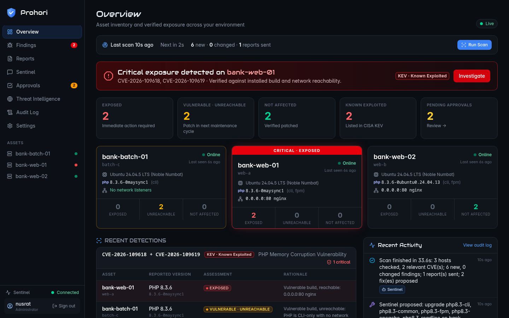

# Prohori

**Agentic exposure management for organizations without a security team.**

Prohori keeps a live inventory of every server, watches vulnerability intelligence (OSV.dev, CISA KEV), and uses **Sentinel**, its AI security threat responder, to decide which servers are *actually* exposed to a new CVE — not just which ones report a matching version number. Sentinel emails the security team an incident report, discusses remediation with admins in chat, and applies only allow-listed, human-approved fixes through a hardened host daemon.

> In October 2026 a critical PHP flaw ("PHP2Shell", CVE-2026-109618 / CVE-2026-109619) pushed Bangladesh Bank, six commercial banks and the Ministry of Land offline for up to three days, because nobody could tell quickly which servers were really vulnerable. Prohori answers that question in minutes.



---

## Hackathon Submission Overview

### Project, Team & Members

| Field | Details |
|---|---|
| **Project Name** | **Prohori** (featuring **Sentinel**, AI Security Threat Responder) |
| **Team Name** | *MIST_Strelitzia* |
| **Team Members** |  **K M Ahnaf Zamil**, **AKM Zawadur Rafid**, **Alif Ul Haque** |

---

## Problem & Solution Summary

### The Problem

When a high-severity CVE drops, most organizations — especially regional banks, government agencies, and mid-sized enterprises without a 24/7 Security Operations Center (SOC) — face two bad choices: ignore the alert deluge or shut systems down blindly.

Traditional vulnerability scanners (and basic version checks) match only headline version numbers (e.g., flagging every server running `PHP 8.3.6` as vulnerable because `8.3.6 < 8.3.36`). In practice, that produces massive false-positive noise because:
1. **Distro backports:** Linux distributions like Ubuntu backport security fixes into older version numbers (e.g., `8.3.6-0ubuntu0.24.04.13` is patched, while `8.3.6-0maysync1` is vulnerable).
2. **Reachability & preconditions:** A vulnerable package installed only for CLI batch jobs or behind a closed port is not an immediate network emergency compared to an internet-facing `php-fpm` worker accepting multipart uploads.
3. **Manual triage bottleneck:** Working out what preconditions an advisory actually requires, checking those facts across dozens of servers, and planning safe mitigations without breaking production takes human analysts days or weeks.

### The Solution

**Prohori** turns alert lists into action with **Sentinel**, an autonomous, guardrailed AI security threat responder. When a new CVE lands, Sentinel doesn't just flag it — it works the incident end to end: confirms which servers are really at risk, alerts the team, proposes and applies containment and fixes, and verifies the result.
- **Always-on detection from live telemetry:** A lightweight host daemon (`prohori-daemon`) wraps `osquery` on each server and connects outbound over WebSockets (`WSS`) to report exact package builds (including the distro *source* package), listening sockets, running services, firewall rules, and allow-listed configuration files. New advisories from OSV.dev and CISA KEV are matched against this inventory the moment they appear. The brain never holds SSH keys or logs into servers.
- **Rapid exposure triage before acting:** With zero hard-coded knowledge of any specific CVE or product, Sentinel reads upstream and distro advisories, extracts checkable exploitability preconditions, runs read-only checks on each affected server, and cites its evidence (`S1`, `S2`…) to classify each host as **Exposed**, **Vulnerable · Unreachable**, or **Not Affected** — so the response targets only the servers that need it instead of shutting everything down.
- **Immediate incident alerting:** As soon as an exposure or severity escalation is confirmed, Sentinel emails the security team an incident report with the affected hosts, evidence, and a ranked response plan.
- **Containment & remediation response:** Sentinel picks containment and fix actions from a strict allow-list (firewall a port, disable a risky feature, set a config directive, upgrade packages, restart a service), discusses operational trade-offs with admins in chat (e.g., keeping a web server online during business hours via a partial mitigation vs. firewalling port 80 vs. full package upgrade), and executes the chosen response through the hardened daemon **only after explicit human approval**.
- **Verified recovery & rollback:** After every action Sentinel re-scans the host to confirm the threat is neutralized, and every change is snapshotted for one-click rollback if it breaks production.
- **Deterministic code guardrails:** Post-model rules enforce hard guarantees — distro-patched builds are always *Not Affected*, uncited or contradicted reachability claims default to *Exposed* (flagged for confirmation), and firewall containment claims are verified against real `iptables` rules.

---

## Features & How the AI Works

### Core Features

- **Real-Time Asset Inventory (`prohori-daemon` + `osquery`):** Tracks OS release, source & binary packages, listening ports, active processes, systemd services, `iptables` rules, and allow-listed configs (`/etc/php/.../php.ini`, `/etc/ssh/sshd_config`, `/etc/nginx/...`).
- **Distro-Ecosystem Vulnerability Matching:** Queries OSV.dev using the host's exact distro ecosystem (`Ubuntu:24.04:LTS`, `Debian:...`) and source package name so backported distro fixes are recognized automatically.
- **Zero-Hardcoding Generalization (Enforced by Audit):** No prompt or scan code mentions any specific CVE ID, product, or mitigation (`bun run prompt-audit`). Sentinel generalizes across completely unseen vulnerabilities — verified against both **PHP2Shell** (`CVE-2026-109618` / `CVE-2026-109619`) and a held-out **regreSSHion** (`CVE-2024-6387` in OpenSSH) scenario (`bun run eval`).
- **Evidence-Cited Precondition Testing:** Every finding displays Sentinel's full reasoning chain: triage justification, extracted threat profile, precondition checks with step citations (`S1`, `S2`…), guardrail overrides, and ranked remediation options.
- **Automated Incident Reports via Email:** Generates executive and technical Markdown/HTML incident reports and delivers them via SMTP whenever a new exposure or severity escalation is detected.
- **Conversational Threat Responder ("Sentinel" Chat):** Admins can ask why a host is safe, inspect live host facts, request custom reports, or push back on a proposed fix and ask Sentinel to revise the proposal in real time.
- **Human-in-the-Loop Remediation & Rollback:** 5 allow-listed daemon actions (`firewall_port`, `upgrade_packages`, `nginx_disallow_uploads`, `set_config_directive`, `restart_service`) with local parameter validation, snapshot backup before execution, one-click rollback, and immediate post-action rescanning.
- **Threat Intelligence Explorer & Full Audit Trail:** Live CISA Known Exploited Vulnerabilities (KEV) browser cross-referenced against fleet inventory, plus an immutable audit log attributing every scan, verdict, email, chat revision, approval note, and rollback.

### Architecture & AI Pipeline

```
 ┌─ Asset (Linux server) ──────────────┐         ┌─ Sentinel brain (apps/brain, Bun) ────────────────────┐
 │ prohori-daemon (TypeScript / Bun)   │   WSS   │ WebSocket gateway · SQLite · HTTP API                 │
 │  ├ osquery: packages, ports, config │ ──────▶ │ Mastra scan workflow (fixed steps, AI inside steps)   │
 │  └ allow-listed remediation runner  │ ◀────── │ Mastra chat agent "Sentinel" (tools, memory)          │
 └─────────────────────────────────────┘ outbound│ cron scans · report email · CISA KEV feed            │
                                         only    └──────────────┬──────────────────────┬─────────────────┘
                                                                │ OSV.dev, CISA KEV    │ LLM (Claude Haiku)
                    ┌─ Dashboard (apps/web, Next.js) ───────────┴──────────────────────┘
                    │ Overview · Findings · Reports · Sentinel chat · Approvals ·
                    │ Threat Intelligence · Audit Log · Settings
                    └────────────────────────────────────────────────────────────────
```

The scan pipeline is implemented as a deterministic 10-step **Mastra Workflow** (`apps/brain/src/scan/workflow.ts`) where AI agents perform reasoning inside bounded steps and deterministic code enforces guarantees between steps:

1. **Inventory (`load-inventory`):** Loads the latest `osquery` snapshot reported by each connected daemon over outbound WebSockets.
2. **Detection (`osv-match`):** Batch-queries OSV.dev against each host's installed source packages and distro ecosystem, cross-referencing the CISA KEV feed.
3. **Triage (`triage` — Sentinel AI + Code Floor Rule):** Sentinel reviews newly matched CVEs in batches and decides which warrant deep investigation (`investigate` vs. `ignore`) with a written rationale (e.g., pre-auth network RCE vs. local CLI bug). A deterministic floor rule in code always includes CISA KEV and distro-critical CVEs.
4. **Fallback Text Extraction (`extract-advisories` — Sentinel AI, Zero Tools):** For advisories lacking structured version ranges, a tool-less LLM step extracts structured affected/fixed ranges from untrusted summary text.
5. **Advisory Analysis (`advisory-analysis` — Sentinel AI, Read-Only Fetch):** For each candidate CVE, Sentinel reads the OSV record, distro notice, KEV entry, and up to 4 referenced vendor advisory URLs to synthesize a structured, cached **`ThreatProfile`** (Zod-validated): affected component, attack vector, checkable host preconditions, complete fix, and partial mitigations with explicit operational trade-offs.
6. **Cross-Host Evidence (`cross-host-evidence` — Deterministic Code):** Computes baseline facts per host (distro patched vs. vulnerable build, listening sockets, Prohori firewall rules) and checks an evidence hash cache so unchanged `(host, CVE)` pairs skip redundant LLM calls.
7. **Host Investigation & Guardrails (`investigate` — Sentinel AI + Code Guardrails):**
   - **Investigation loop:** Per affected asset, Sentinel runs a bounded read-only tool loop (`runHostQuery` for `listening_ports`, `services`, `config_file`, `processes`, `firewall_rules`) to test every precondition in the threat profile and outputs a verdict with step citations (`S1`, `S2`…).
   - **Code guardrails:** A build the distro marks as patched is unconditionally set to **Not Affected**. If Sentinel claims a vulnerable build is **Vulnerable · Unreachable** without citing evidence steps — or if its claim contradicts deterministic facts — code overrides the verdict to **Exposed**, flags `needsConfirmation`, and records the override in `investigation.guardrail`.
   - **Remediation planning:** Sentinel ranks containment, partial mitigation, and complete fix actions from the daemon's allow-list, respecting platform constraints (e.g., port `22/tcp` can never be firewalled, so for OpenSSH `regreSSHion` Sentinel selects `set_config_directive` with `LoginGraceTime 0` as partial mitigation and package upgrade as the complete fix).
8. **Persistence & Auditing (`upsert-findings`):** Saves findings, detects status escalations/de-escalations, records audit events, and clears re-assessment indicators.
9. **Incident Reporting (`report` — Sentinel AI + Nodemailer):** When new exposures or escalations occur, Sentinel writes a cohesive Markdown incident report contrasting exposed hosts, unreachable vulnerable hosts, and patched hosts, then emails it to the security team.
10. **Auto-Proposal (`propose-fixes`):** Automatically creates `pending` action proposals for both immediate containment and the complete fix on exposed hosts, validating parameters against Zod schemas and closing obsolete proposals when findings resolve.

### Conversational Agent ("Sentinel" Chat)

The interactive Sentinel agent (`apps/brain/src/agent/prohori.ts`) uses **Mastra Agent** with persistent **Mastra Memory** (`@mastra/libsql`) and 15 read/propose tools (`listHosts`, `getInventory`, `runHostQuery`, `lookupCve`, `checkKev`, `findVulnsForPackage`, `listFindings`, `getFinding`, `getThreatProfile`, `runScanNow`, `sendReport`, `proposeFix`, `reviseProposal`, `getAction`, `listActions`).

### Safety Model

- **The daemon runs only named `osquery` queries and allow-listed actions,** validating parameters locally with Zod and refusing to touch SSH port 22. It never executes arbitrary shell commands or raw SQL from the network.
- **Sentinel can propose and revise, but never approve.** There is no approve tool in the agent's toolset; approval requires an authenticated human click (`POST /api/actions/:id/approve`), recorded with the admin's username and note.
- **Advisory text is treated as untrusted data:** the AI steps that read external advisory text have no action or host tools, mitigating indirect prompt injection.
- **Every remediation requires human approval and supports rollback.** Before changing `iptables`, config directives, nginx snippets, or apt packages, the daemon records pre-change state on disk so any applied action can be rolled back cleanly.

---

## Tech Stack, Models, APIs & Datasets

### Tech Stack

| Layer | Technologies |
|---|---|
| **Runtime & Monorepo** | [Bun](https://bun.sh) 1.4+ (workspaces, HTTP & WebSocket server, `bun:sqlite`, standalone Linux binary compiler), TypeScript 7 |
| **AI Agent & Workflow Engine** | [Mastra](https://mastra.ai) (`@mastra/core`, `@mastra/memory`, `@mastra/libsql`, `@mastra/ai-sdk`), [Vercel AI SDK](https://sdk.vercel.ai) (`ai`, `@ai-sdk/anthropic`, `@ai-sdk/react`), [Zod](https://zod.dev) v4 |
| **Web Dashboard (`apps/web`)** | [Next.js](https://nextjs.org) 16 (App Router), React 19, Tailwind CSS 4, Lucide React, `react-markdown`, `remark-gfm` |
| **Brain Backend (`apps/brain`)** | Bun HTTP/WSS gateway, SQLite (`bun:sqlite` for state/inventory/findings/audit), libSQL (`@mastra/libsql` for chat memory), Croner, Nodemailer, Marked |
| **Host Daemon (`apps/daemon`)** | TypeScript compiled via `bun build --compile` to a standalone Linux x64 binary (`prohori-daemon`), wrapping `osqueryi`, `iptables`, `apt-get`, and `systemctl`/`service` |
| **Lab Infrastructure (`infra/`)** | Docker & Docker Compose, Ubuntu 24.04 LTS target containers (`nginx`, `php8.3-fpm`, `php8.3-cli`, `openssh-server`), Mailpit (SMTP + Web UI) |

### Models

- **Primary LLM:** **Claude Haiku (`claude-haiku-5-5`)** accessed via an Anthropic Messages API-compatible endpoint (**OpenCode Go**, `https://opencode.ai/inference/go/anthropic/v1`, configurable via `LLM_BASE_URL` and `LLM_MODEL` in `.env` to work with any Anthropic-compatible provider).
- **Usage pattern:** Structured outputs (`agent.generate(..., { structuredOutput: { schema } })`) with Zod schemas for deterministic JSON contracts in triage, advisory parsing, threat profiling, host investigation, and remediation planning; streaming tool-calling generation for the interactive Sentinel chat and Markdown incident reports.

### External APIs & Datasets

| API / Dataset | Purpose in Prohori |
|---|---|
| **[OSV.dev API](https://osv.dev)** (`/v1/query`, `/v1/querybatch`, `/v1/vulns/:id`) | Primary open-source and Linux distribution vulnerability database. Queried with distro ecosystems (`Ubuntu:24.04:LTS`) and source package names to retrieve upstream ranges, Ubuntu/Debian fixed versions (`UBUNTU-CVE-*`, `DEBIAN-CVE-*`), CVSS vectors, and advisory reference URLs. |
| **[CISA KEV Catalog](https://www.cisa.gov/known-exploited-vulnerabilities-catalog)** (`known_exploited_vulnerabilities.json`) | Live feed of vulnerabilities known to be actively exploited in the wild. Used as a mandatory floor rule in triage, for Critical priority escalation, and in the dashboard's **Threat Intelligence** tab. |
| **Vendor & Distro Advisory Feeds** | Upstream advisories linked from OSV records (e.g., PHP announcements, Ubuntu Security Notices, OpenWall / Qualys disclosures) fetched read-only by Sentinel's advisory analyst to build `ThreatProfile` preconditions and mitigations. |
| **[Ubuntu Snapshot Archive](https://snapshot.ubuntu.com)** | Time-travel APT archive (`20261101T000000Z`) used when building the Docker lab targets so superseded historical package builds (`php8.3` `8.3.6-0maysync1` and `8.3.6-0ubuntu0.24.04.13`, `openssh` `1:9.6p1-3ubuntu13`) are reproducibly installed while keeping live archives available for runtime upgrades. |

---

## AI Tools Used & For What

### 1. In-Application AI (Runtime Intelligence)

- **Mastra (`@mastra/core`, `@mastra/memory`) + Vercel AI SDK (`ai`, `@ai-sdk/anthropic`):** Orchestrates the 10-step scan workflow, structured output schemas, bounded investigation tool loops, and multi-turn chat memory.
- **Claude Haiku (`claude-haiku-5-5` via OpenCode Go):**
  - *CVE Triage:* Filters noisy raw package matches down to genuinely dangerous vulnerabilities.
  - *Advisory Synthesis:* Reads unstructured vendor advisories and produces structured `ThreatProfile` objects with checkable preconditions and mitigation trade-offs.
  - *Host Investigation:* Chooses and executes read-only `osquery` inspection steps on each host and cites step IDs (`S1`, `S2`…) to prove or disprove network exposure.
  - *Remediation Planning:* Selects and ranks allow-listed fixes around host constraints (such as non-firewallable SSH port 22).
  - *Incident Reporting & Interactive Chat:* Writes email reports and collaborates with admins to review or revise remediation proposals.

### 2. Development AI Tools (Build & Engineering Process)

- **Claude Code / OpenCode / Antigravity (AI Coding Assistants):**
  - *Multi-Agent Modular Development:* Used with explicit shared TypeScript contracts (`packages/shared` and [`docs/CONTRACTS.md`](docs/CONTRACTS.md)) to build the daemon, brain workflow, and Next.js dashboard in parallel without contract drift.
  - *Generalization & Evaluation Harness:* Assisted in writing the automated evaluation runner (`scripts/eval.ts`) and static prompt auditor (`scripts/prompt-audit.ts`) that verifies zero CVE-specific hardcoding.
  - *Documentation & Runbooks:* Assisted in drafting the live presentation runbook ([`docs/DEMO.md`](docs/DEMO.md)) and submission documentation.

---

## Third-Party Code & Assets (Credited)

Prohori is built on original application code in `apps/`, `packages/`, `infra/`, and `scripts/`, powered by the following open-source libraries, tools, datasets, and assets:

- **[osquery](https://osquery.io/)** (Linux Foundation / Meta, Apache-2.0 / GPL-2.0) — SQL-powered operating system instrumentation and telemetry agent installed in the target containers and VM installer (`osquery_5.24.1-1.linux_amd64.deb`).
- **[Mastra](https://mastra.ai/)** (`@mastra/core`, `@mastra/memory`, `@mastra/libsql`, `@mastra/ai-sdk`, Apache-2.0) — TypeScript framework for AI agents, workflows, and persistent memory.
- **[Vercel AI SDK](https://sdk.vercel.ai/)** (`ai`, `@ai-sdk/anthropic`, `@ai-sdk/react`, Apache-2.0) — Unified LLM provider client and React streaming hooks.
- **[Bun](https://bun.sh/)** (Oven, MIT) — JavaScript/TypeScript runtime, package manager, single-file binary compiler, and built-in SQLite driver.
- **[Next.js](https://nextjs.org/) & [React](https://react.dev/)** (Vercel / Meta, MIT) — Web application framework and UI library for the dashboard.
- **[Tailwind CSS](https://tailwindcss.com/)** (Tailwind Labs, MIT), **[Lucide Icons](https://lucide.dev/)** (`lucide-react`, ISC), `clsx` (MIT), and `tailwind-merge` (MIT) — Styling and iconography.
- **[Google Fonts](https://fonts.google.com/)** (**Audiowide**, **Inter**, **JetBrains Mono**, **Noto Sans Bengali**, SIL Open Font License 1.1) — Typography loaded via `next/font/google` and CSS theme variables.
- **[Zod](https://zod.dev/)** (Colin McDonnell, MIT) — Runtime schema validation for WebSocket messages, daemon actions, and LLM structured outputs.
- **[Croner](https://github.com/hexagon/croner)** (Hexagon, MIT) — Cron scheduler for periodic vulnerability scans and CISA KEV refreshes.
- **[Nodemailer](https://nodemailer.com/)** (Andris Reinman, MIT-0) & **[Marked](https://marked.js.org/)** (MIT) — HTML/Markdown email rendering and SMTP delivery.
- **[react-markdown](https://github.com/remarkjs/react-markdown)** & **[remark-gfm](https://github.com/remarkjs/remark-gfm)** (remarkjs, MIT) — GitHub-Flavored Markdown rendering in chat and reports.
- **[Mailpit](https://mailpit.axllent.org/)** (`axllent/mailpit` Docker image, MIT) — Local SMTP catcher and web inbox for inspecting incident report emails.
- **[Ubuntu 24.04 LTS (`noble`)](https://ubuntu.com/)** (Canonical Ltd.) — Base Docker container image and APT packages (`nginx`, `php8.3`, `openssh`, `iptables`) for the simulated bank servers.
- **[OSV.dev](https://osv.dev/)** (Google Open Source Security Team, Apache-2.0 / CC-BY-4.0) & **[CISA KEV Catalog](https://www.cisa.gov/known-exploited-vulnerabilities-catalog)** (CISA, U.S. Public Domain) — Vulnerability intelligence datasets.

---

## Setup Steps


### Prerequisites

| Tool | Version |
|---|---|
| [Bun](https://bun.sh) | 1.4+ |
| Docker with Compose | 24+ |
| An Anthropic-compatible LLM endpoint | OpenCode Go (`claude-haiku-5-5`) is the default |

Free ports: **3000** (dashboard), **4400** (brain), **8081 / 8082** (lab web servers), **1025 / 8025** (Mailpit).

### Option A: One-Command Demo Startup (Linux / WSL)

After configuring `.env`, you can launch the Docker lab containers, Sentinel brain, production web dashboard, and pre-flight healthcheck in one command:

```bash
cp .env.example .env          # set OPENCODE_API_KEY in .env
bun run setup                 # install dependencies & compile the Linux daemon binary
./start-demo.sh               # starts Docker targets, brain (:4400), web (:3000) & runs healthcheck
```

### Option B: Step-by-Step Setup

#### 1. Install and configure

```bash
git clone git@gitlab.com:ahnaf-zamil/prohori.git
cd prohori
cp .env.example .env          # then set OPENCODE_API_KEY
bun run setup                 # installs dependencies and builds the host daemon
```

#### 2. Start the lab assets

```bash
bun run targets:up            # bank-web-01, bank-web-02, bank-batch-01, bank-ssh-01 + Mailpit
```

#### 3. Start Sentinel and the dashboard (two terminals)

```bash
bun run brain                 # terminal 1 — Sentinel brain on :4400
bun run web:prod              # terminal 2 — dashboard on :3000 (production build)
```

#### 4. Verify

```bash
bun run healthcheck
```

Open **http://localhost:3000** and sign in as `zamil` or `nusrat` (password `prohori-admin`, set in `ADMIN_USERS`). Report emails arrive in Mailpit at **http://localhost:8025**.

> Use `bun run web:prod` for demos. The dev server (`bun run web`) works, but hot reload can loop when the dashboard is opened from Windows into WSL.

---

## The Lab Scenarios & Evaluation

### Primary Scenario: PHP2Shell (`CVE-2026-109618` / `CVE-2026-109619`)

All three lab assets report **PHP 8.3.6** — a version-number check flags every one of them. Sentinel shows that only one is an emergency.

| Asset | PHP build | Serving | Sentinel's assessment |
|---|---|---|---|
| bank-web-01 (`web-a`) | `8.3.6-0maysync1` (vulnerable) | nginx + php-fpm on :80 | **Exposed** · Critical · CISA KEV |
| bank-web-02 (`web-b`) | `8.3.6-0ubuntu0.24.04.13` (patched backport) | nginx + php-fpm on :80 | **Not Affected** |
| bank-batch-01 (`batch-c`) | `8.3.6-0maysync1` (vulnerable) | PHP CLI only, nothing listening | **Vulnerable · Unreachable** |

PHP2Shell is **embargoed** until you click **Replay Disclosure** for it in **Settings → Demonstration Controls**, so the live demo shows Sentinel discovering a new CVE on its own.

### Held-Out Scenario: regreSSHion (`CVE-2024-6387` — Generalization Check)

A second scenario that no prompt or line of scan code mentions. It exercises everything the PHP2Shell path does not: the CVE is not on CISA KEV and is not distro-critical (so only Sentinel's triage picks it up), the vulnerable service listens on SSH port 22 (which Prohori never firewalls, so Sentinel must plan around it), and its documented mitigation (`LoginGraceTime 0`) is partial with a denial-of-service trade-off that Sentinel has to find in the advisory.

| Asset | OpenSSH build | Serving | Expected |
|---|---|---|---|
| bank-ssh-01 (`ssh-d`) | `1:9.6p1-3ubuntu13` (vulnerable) | sshd on :22 | **Exposed** · High |
| bank-web-02 (`web-b`) | latest noble-security (patched) | sshd on :22 | **Not Affected** |
| bank-batch-01 (`batch-c`) | `1:9.6p1-3ubuntu13`, client only | no sshd | **Vulnerable · Unreachable** |

### Automated Evaluation & Prompt Audit

```bash
bun run eval           # replays PHP2Shell 3× and regreSSHion 1× against expected verdicts
bun run prompt-audit   # fails if any prompt or scan code names a specific CVE, product or CVE-specific mitigation
```

The evaluation checks every asset's verdict and priority, that each finding carries an investigation, and that every non-safe finding has a remediation plan. A newly disclosed CVE takes roughly 60–120 s from disclosure to verdict (Sentinel analyses the advisory once and caches the profile).

The full presentation runbook — pre-flight checklist, click-by-click script, talking points and recovery — is in **[docs/DEMO.md](docs/DEMO.md)**.

---

## Configuration

All settings live in the root `.env` (see [`.env.example`](.env.example) for every option).

| Variable | Purpose |
|---|---|
| `OPENCODE_API_KEY`, `LLM_BASE_URL`, `LLM_MODEL` | Sentinel's model (Anthropic Messages API format) |
| `BRAIN_PORT`, `BRAIN_API_TOKEN` | Brain port and the shared secret used by the dashboard |
| `SEED_HOSTS` | Pre-enrolled lab assets (`id:name:token`) |
| `DEMO_SCENARIOS`, `DEMO_REPLAY_HOLD` | Replayable disclosures and their CVEs (embargoed until replayed) |
| `SMTP_HOST`, `SMTP_PORT`, `REPORT_FROM`, `DEFAULT_REPORT_EMAILS` | Report delivery |
| `ADMIN_USERS`, `SESSION_SECRET` | Dashboard accounts and session signing |

Scan interval and report recipients can also be changed at runtime in **Settings**.

---

## Commands

| Command | What it does |
|---|---|
| `bun run setup` | Install dependencies and build the daemon binary |
| `bun run targets:up` / `targets:down` | Start / stop the Docker lab assets and Mailpit |
| `bun run targets:reset` | Recreate the lab assets from their images (restores the original PHP builds) |
| `bun run brain` | Run the Sentinel brain |
| `bun run web:prod` | Build and serve the dashboard |
| `bun run web` | Dashboard in development mode |
| `bun run daemon:build` | Rebuild `apps/daemon/bin/prohori-daemon` (restart the lab containers afterwards) |
| `bun run healthcheck` | Pre-flight check of every dependency |
| `bun run eval` | Replay each scenario and score Sentinel's verdicts |
| `bun run prompt-audit` | Verify no CVE- or product-specific knowledge is hard-coded |

---

## Project Layout

```
apps/
  daemon/   Host daemon: osquery collection, outbound WebSocket, allow-listed actions with rollback
  brain/    Sentinel: gateway, SQLite, Mastra scan workflow + chat agent, OSV/KEV clients, email, HTTP API
  web/      Next.js dashboard
packages/
  shared/   Contracts shared by all apps: domain types, WebSocket protocol, named queries, actions, API
infra/
  docker-compose.yml   Lab assets (Ubuntu 24.04: nginx/PHP builds, OpenSSH builds) and Mailpit
  targets/             Lab asset image and sample bank site
  vm/install-daemon.sh Daemon installer for real Ubuntu servers (systemd, sudoers allow-list)
scripts/
  healthcheck.ts       Pre-flight check
  eval.ts              Scenario evaluation (expectations in eval-scenarios.json)
  prompt-audit.ts      Guard against hard-coded CVE knowledge
docs/
  DEMO.md       Presentation runbook
  CONTRACTS.md  Internal build contract and design notes
```

## Running on Real Servers

`infra/vm/install-daemon.sh` installs `osquery` and the daemon as a `systemd` service on Ubuntu 24.04, with a dedicated user and a `sudoers` allow-list limited to the remediation commands. Use **Settings → Add Asset** to generate an enrollment token and the install command, and set `BRAIN_PUBLIC_URL` so the command points at a brain address the server can reach. This path is written but has not yet been exercised end to end.

